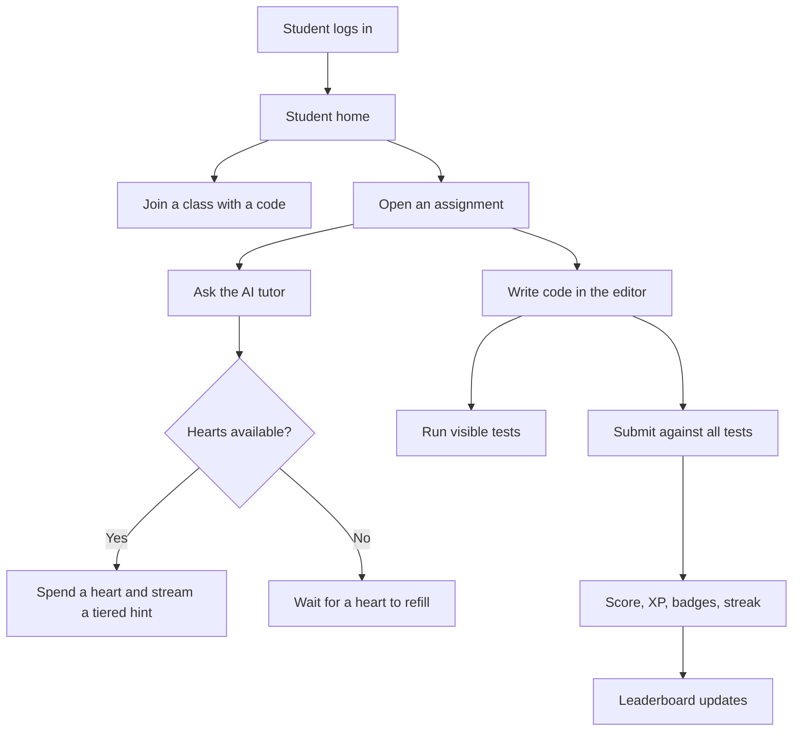
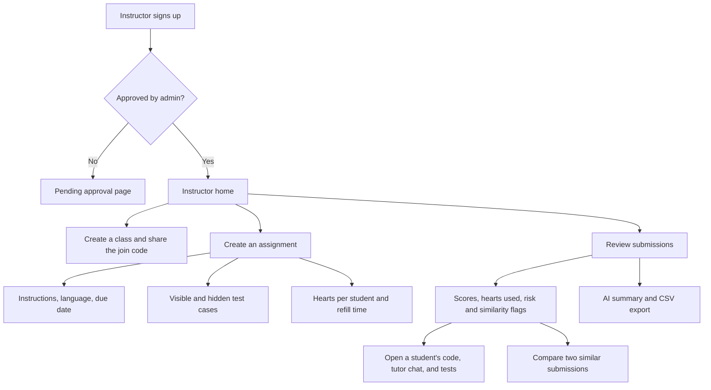
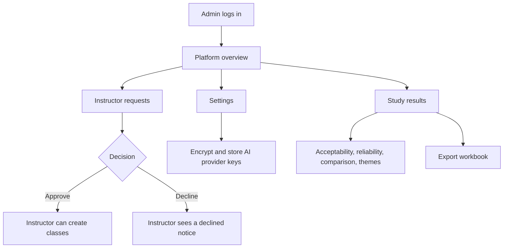
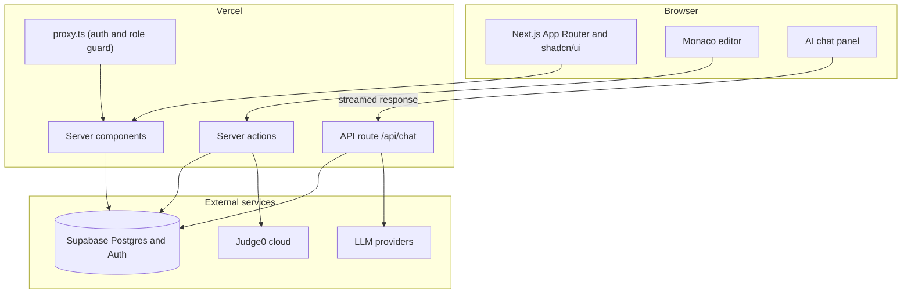
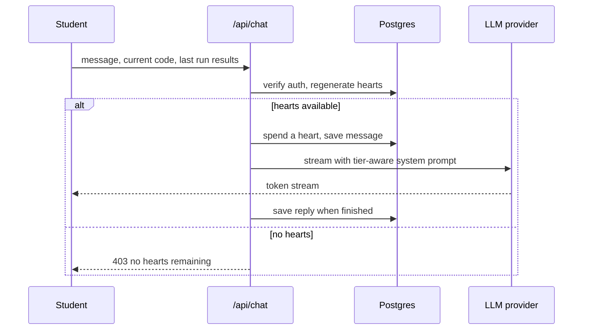
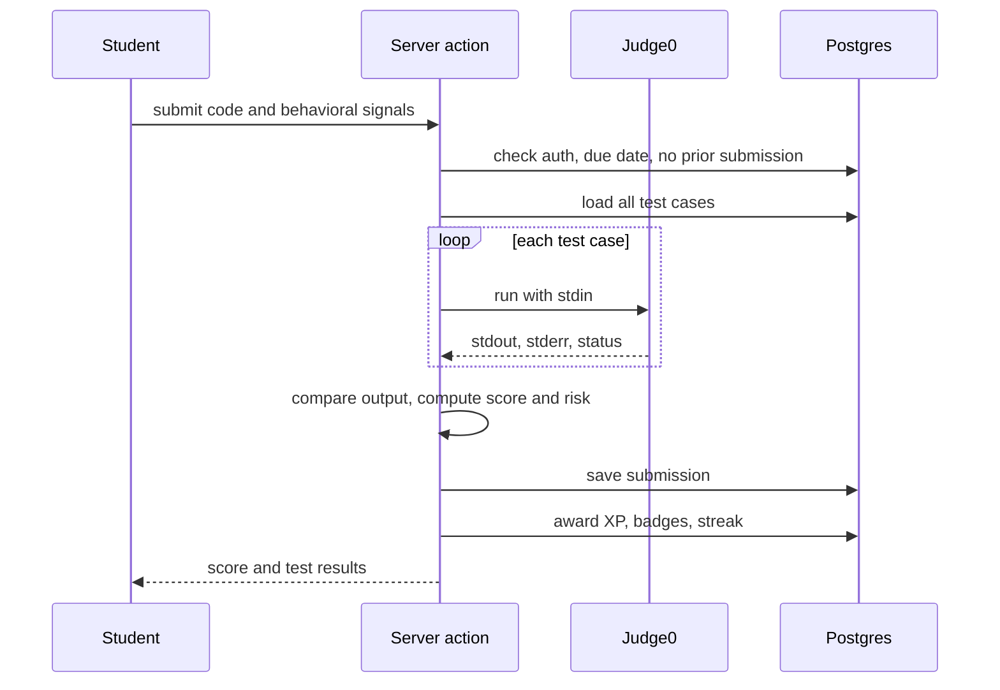

<p align="center">
  
</p>

<h1 align="center">PACE</h1>

<p align="center">
  <strong>Programming AI-assisted Coding Environment</strong><br />
  A gamified coding workspace where an AI tutor gives hints, never answers.
</p>

<p align="center">
  
  
  
  
  
  
  
</p>

PACE is a research prototype built by students of the Polytechnic University of the Philippines, Quezon City. It was previously called GAITS, and the repository is still named `fr-gaits`. It is not a commercial product.

---

## Table of contents

1. [The problem](#the-problem)
2. [Our approach](#our-approach)
3. [Roles and pages](#roles-and-pages)
4. [The research study](#the-research-study)
5. [Architecture](#architecture)
6. [How the main features work](#how-the-main-features-work)
7. [Tech stack](#tech-stack)
8. [Getting started](#getting-started)
9. [Testing](#testing)
10. [Deployment](#deployment)
11. [Project structure](#project-structure)

---

## The problem

Programming courses struggle with four things at once:

- Students get stuck and nobody is there to help in the moment.
- General-purpose AI tools hand out complete solutions, so students copy instead of learn.
- Assignments feel repetitive, with no sense of progress.
- Instructors cannot give one-on-one help to dozens of students at the same time.

## Our approach

PACE puts the editor, the test runner, and the AI tutor in one place, and limits how much help a student can ask for.

1. **Hearts-gated AI tutor.** Each assignment gives a student a set number of hearts. Every tutor question costs one heart, and hearts come back on a timer set by the instructor.
2. **Tiered hints.** The more hearts a student has spent, the more specific the hint gets, from a gentle nudge up to near-pseudocode. The tutor never writes the solution or the corrected code.
3. **Secure code execution.** Code runs in the Judge0 sandbox against visible and hidden test cases.
4. **Integrity signals.** Paste activity, typing, and focus time feed a risk score, and a structural similarity check compares submissions within an assignment. Both are prompts for the instructor to review, not proof of copying.
5. **Gamification.** XP, levels, badges, weekly streaks, and class leaderboards keep students engaged.
6. **Role-based dashboards.** Students, instructors, and admins each get their own interface.

---

## Roles and pages

| Role | What they can do |
|------|------------------|
| **Student** | Join classes with a code, see a to-do list, write code in a Monaco editor, run visible tests, ask the AI tutor, submit, earn XP and badges, view the class leaderboard |
| **Instructor** | Create classes, build assignments with test cases and tutor settings, review submissions and flags, compare similar submissions, export scores, archive classes |
| **Admin** | Approve or decline instructor requests, manage AI provider keys, check system status, view the research study results |

### Key routes

| Route | Purpose |
|-------|---------|
| `/` | Public landing page |
| `/login`, `/signup` | Authentication with role selection |
| `/research/questionnaire` | Public, anonymous evaluation questionnaire |
| `/dashboard/student` | Home, to-do, archive, class pages, assignment workspace |
| `/dashboard/student/assignments/[id]` | Workspace with resizable instructions, editor, console, and tutor panels |
| `/dashboard/instructor` | Home with stats, assignments table, and class join codes |
| `/dashboard/instructor/assignments/new` and `.../[id]/edit` | Assignment form with live checklist and local drafts |
| `/dashboard/instructor/submissions` | Assignment list, per-assignment overview, per-student review, side-by-side compare |
| `/dashboard/admin` | Platform overview, instructor requests, system status |
| `/dashboard/admin/approvals` | Pending and reviewed instructors |
| `/dashboard/admin/study-results` | Overview, Items, Comments, and Respondents tabs, with `.xlsx` export |
| `/dashboard/admin/settings` | AI provider keys and system status |

Dashboard navigation shows a blurred loading overlay with a beating Pace heart for at least 1.5 seconds.

### Student flow



### Instructor flow



### Admin flow



---

## The research study

PACE is evaluated with a technology acceptance questionnaire covering four constructs: perceived usefulness (PU), perceived ease of use (PEOU), attitude toward use (ATU), and behavioral intention (BI). Each construct has five statements rated from 1 to 5.

- **Collecting responses.** Participants answer at `/research/questionnaire` without logging in. They choose a student or instructor version, answer a short "About you" section, rate 20 statements, and may leave three optional comments. Responses are stored anonymously in the `study_responses` table with no user link.
- **Reading results.** Admins see weighted means with interpretation bands, Cronbach's alpha per construct, a Mann-Whitney U comparison of students and instructors, an items view with the distribution of answers per statement, and a comments view.
- **Coding comments.** Admins tag each comment with one or more themes and can add new themes.
- **Closing.** Closing the questionnaire stops new responses and switches reliability from the pilot sample to the final data.
- **Export.** Results download as an `.xlsx` workbook.

The student target uses Slovin's formula (N = 652, e = 0.05, giving 248 students).

---

## Architecture

### System overview



### Data model

```mermaid
erDiagram
    User ||--o{ Class : teaches
    User ||--o{ Enrollment : enrolls
    User ||--o{ Submission : submits
    User ||--o{ ChatMessage : sends
    User ||--o{ HeartsState : has
    User ||--o{ XpEvent : earns
    User ||--o{ UserBadge : earns
    User ||--o{ Notification : receives
    User ||--o| Streak : keeps

    Class ||--o{ Enrollment : has
    Class ||--o{ AssignmentClass : assigns
    Class ||--o{ Post : stream

    Assignment ||--o{ AssignmentClass : assigned_to
    Assignment ||--o{ TestCase : has
    Assignment ||--o{ Submission : receives
    Assignment ||--o{ HeartsState : tracks
    Assignment ||--o{ ChatMessage : contains
    Assignment ||--o{ CodeDraft : autosaves

    Post ||--o{ Comment : has
    Badge ||--o{ UserBadge : awarded
```

Two tables stand alone: `SystemSetting` (key and value store for provider keys and study flags) and `StudyResponse` (anonymous questionnaire answers).

### Tutor request flow



### Submission flow



---

## How the main features work

### Tiered hints

The tier is based on hearts spent, capped at five.

| Tier | Level name | What the tutor gives |
|------|------------|----------------------|
| 1 | Gentle nudge | A vague conceptual nudge |
| 2 | Concept hint | A general strategy |
| 3 | Specific steps | Specific logic, step by step |
| 4 | Guided walkthrough | A structural outline of control flow and variables |
| 5 | Near-pseudocode | A near-pseudocode translation |

An intent guardrail makes the tutor decline requests for a full solution or corrected code, while still explaining code, tracing output, and pointing at where a bug likely is.

### Hearts

Each student has a heart count per assignment. When hearts are below the maximum, they regenerate one per cooldown period, using the elapsed time since the last refill. The instructor sets both the maximum and the cooldown for each assignment.

### Integrity signals

- **Behavioral risk score.** Paste size relative to final code, paste timing, idle time before pasting, keystroke ratio, and low-effort run patterns combine into a Low, Medium, or High flag.
- **Similarity.** Submissions are tokenized with tree-sitter and compared with winnowing fingerprints. Pairs at 40 percent or higher are flagged, and an instructor can open both submissions side by side.

### XP, levels, and badges

| Event | XP |
|-------|----|
| Passing tests | 10 per test-case share of the score |
| Perfect score | 50 |
| Submitting with no hints | 30 |
| Submitting with 1 or 2 hints | 15 |
| Keeping a weekly streak | 20 |

Level thresholds in total XP: 0, 100, 250, 500, 800, 1200, 1700, 2300, 3000, 4000, 5000.

Badges: First Submit, Perfect Score, Five Perfects, 5-Week Streak, 10-Week Streak, XP Master (1000 XP), and XP Legend (5000 XP).

### AI provider selection

1. If the class has its own provider and key, that is used first. Keys are encrypted with AES-256-GCM before storage.
2. Otherwise the default is Groq from the `GROQ_API_KEY` environment variable.
3. Then Google from `GOOGLE_GENERATIVE_AI_API_KEY`.
4. Finally any key an admin saved in system settings.

If none are available, the request fails with a clear error.

---

## Tech stack

| Layer | Technology |
|-------|-----------|
| Framework | Next.js 16 (App Router), React 19, TypeScript 5 |
| UI | Tailwind CSS 4, shadcn/ui, Base UI, lucide-react |
| Editor | Monaco (`@monaco-editor/react`) |
| Panels | `react-resizable-panels` |
| AI | Vercel AI SDK with Groq, Google, OpenAI, and Anthropic providers |
| Database | PostgreSQL on Supabase |
| ORM | Prisma 7 with `@prisma/adapter-pg` |
| Auth | Supabase Auth with role and approval metadata |
| Code execution | Judge0 cloud (Python, C, JavaScript, C#) |
| Similarity | `web-tree-sitter` and winnowing |
| Reports | `exceljs` for the study workbook |
| Tests | Vitest |
| Hosting | Vercel |

---

## Getting started

### Prerequisites

- Node.js 20 or newer
- A Supabase project (Postgres and Auth)
- At least one LLM API key (Groq is the default)

### Environment variables

Copy `.env.example` to `.env.local` and fill in the values.

| Variable | Purpose |
|----------|---------|
| `DATABASE_URL` | Postgres connection string. On Vercel, use the transaction pooler (port 6543). |
| `NEXT_PUBLIC_SUPABASE_URL` | Supabase project URL |
| `NEXT_PUBLIC_SUPABASE_ANON_KEY` | Supabase anon key |
| `SERVICE_ROLE_KEY` | Supabase service role key, used for admin actions |
| `ENCRYPTION_KEY` | Secret used to encrypt stored API keys |
| `GROQ_API_KEY` | Default AI provider |
| `GOOGLE_GENERATIVE_AI_API_KEY` | Backup AI provider |
| `GITHUB_TOKEN` | Creates issues from the in-app report-an-issue button |
| `NEXT_PUBLIC_ADMIN_CONTACT_EMAIL` | Shown to instructors waiting for approval |

Judge0 runs on the public cloud endpoint and needs no key.

Never commit real `.env` files. Only `.env.example` is tracked.

### Run locally

```bash
npm install
npx prisma generate
npx prisma db push
npm run dev
```

Open [http://localhost:3000](http://localhost:3000).

Row level security is enabled on every table in the Supabase project. If you add a model, enable it on the new table as well.

### Seed demo classes

With an approved instructor and a student account already created:

```bash
node scripts/seed-classes.js instructor@example.com student@example.com
```

This creates three classes with five assignments each and enrolls the student. It skips classes that already exist.

### Scripts

| Command | What it does |
|---------|--------------|
| `npm run dev` | Start the dev server |
| `npm run build` | Production build |
| `npm run start` | Run the production build |
| `npm run lint` | Run ESLint |
| `npm test` | Run the Vitest suite once |
| `npm run test:watch` | Run Vitest in watch mode |

---

## Testing

Pure logic (scoring helpers, statistics, form validation, date helpers, the study analysis) has unit tests that run without a database. A number of server action tests create and delete real rows, so they need a working `DATABASE_URL`. Point them at a development database, not production.

```bash
npm test
```

---

## Deployment

The app deploys to Vercel from `main`. The build command is set in `vercel.json`:

```bash
npx prisma generate && next build
```

Notes for production:

- Use the Supabase **transaction pooler** (port 6543) for `DATABASE_URL`. The session pooler has a small connection cap that serverless functions can exhaust.
- The Prisma pool is capped at three connections per instance with a short idle timeout.
- The function region is Singapore (`sin1`).

---

## Project structure

```
fr-gaits/
├── app/
│   ├── actions/              Server actions (classes, assignments, submissions, study, admin)
│   ├── api/chat/             Streaming AI tutor endpoint
│   ├── dashboard/
│   │   ├── student/          Home, to-do, archive, classes, workspace
│   │   ├── instructor/       Home, assignments, submissions, classes, archive
│   │   └── admin/            Overview, approvals, study results, settings
│   ├── research/questionnaire/   Public evaluation questionnaire
│   ├── login/ signup/ ...    Auth and legal pages
│   └── page.tsx              Landing page
├── components/
│   ├── ui/                   shadcn/ui primitives
│   └── features/             Feature folders (student, instructor, admin, research, landing, ...)
├── hooks/                    Shared React hooks
├── lib/                      Domain logic (hearts, gamification, similarity, study analysis, data loaders)
├── prisma/schema.prisma      Database schema
├── scripts/                  One-off scripts such as the demo class seeder
├── public/                   Static assets and logos
├── proxy.ts                  Session refresh and role-based route guard
└── vercel.json               Build and region configuration
```

Pages stay thin: each one fetches data on the server and renders a single feature component from `components/features`.
